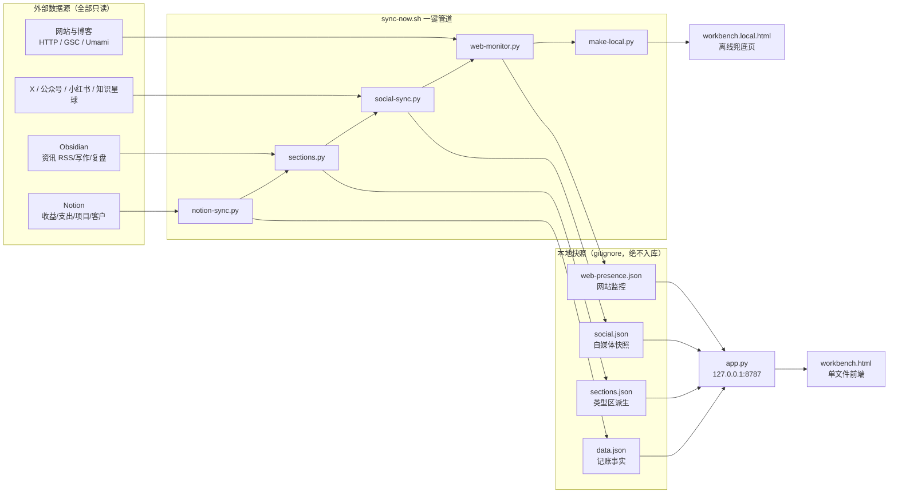

# 数据同步管道

所有外部系统（Notion、Obsidian、自媒体平台、网站）默认只读。例外是工作台内对 Obsidian 已存在章节的显式写作保存：它仍受本地令牌、稳定 ID、路径边界、哈希冲突检测和写入前备份保护；项目、客户与专注记录只在用户显式点击后按字段白名单回写 Notion。

## 数据流

## 步骤说明

`scripts/sync-now.sh` 按固定顺序执行，每步失败码独立：

| 步 | 脚本 | 产物 | 失败码 |
|---|---|---|---|
| 0 | 前置检查（`ntn` 存在 + 代理通路 401） | — | 2 / 3 |
| 1 | `scripts/sync/notion-sync.py` | `data.json`（原子写 + 轮转备份 + 骤降护栏） | 4 |
| 2 | `scripts/sync/sections.py --write` | `sections.json`（必须在 make-local 之前） | 6 |
| 3 | `scripts/sync/social-sync.py` | `social.json` | 7 |
| 4 | `scripts/sync/web-monitor.py` | `web-presence.json`（失败只告警） | — |
| 4b | `scripts/sync/make-local.py` | `workbench.local.html` 离线兜底页 | 5 |

**顺序为什么不能变**：`make-local.py` 会把 `sections.json` 整份内嵌进离线页，先建页后建快照会把上一版数据嵌进去，页面上看不出任何异常，只是数据旧了。

## 关键不变式

- **data.json 是唯一的记账事实**，`sections.json` / `social.json` 都是可重算的派生快照
- 页面对四份快照**只读**；写作保存直接写回 `Obsidian-Tech/projects/` 的 Markdown，且每次写入前备份到 `backups/obsidian-writing/`
- Notion 只承载项目、客户、状态等元数据，不复制写作正文；正文唯一真源保持在 Obsidian，避免双写覆盖
- 每条同步写入 `sync-log.json`（最近 20 条），前端「同步日志」展示启动日志式步骤明细；`sync-now.sh` 以 `__WB_STEP__` 机器标记输出分阶段耗时，后端解析后标出最慢阶段
- 未接入的通道在页面上显示「未接入 / 未核验」，绝不伪装成 0

## 相关脚本

| 目录 | 用途 |
|---|---|
| `scripts/sync/` | 管道步骤（上表） |
| `scripts/tools/` | 独立工具：打开链接、装 launchd 服务、GSC 快照、AI 用量、Notion API 小工具 |
| `scripts/diagnostics/` | 诊断探针：Notion data source 结构、旧连接器状态（非关键路径） |
| `scripts/tests/` | 499 逻辑断言 + 147 冒烟 + 69 变异 + live 端到端 |
